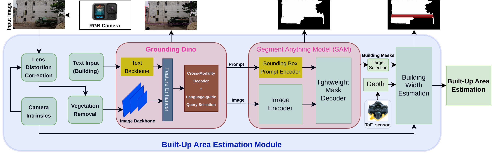
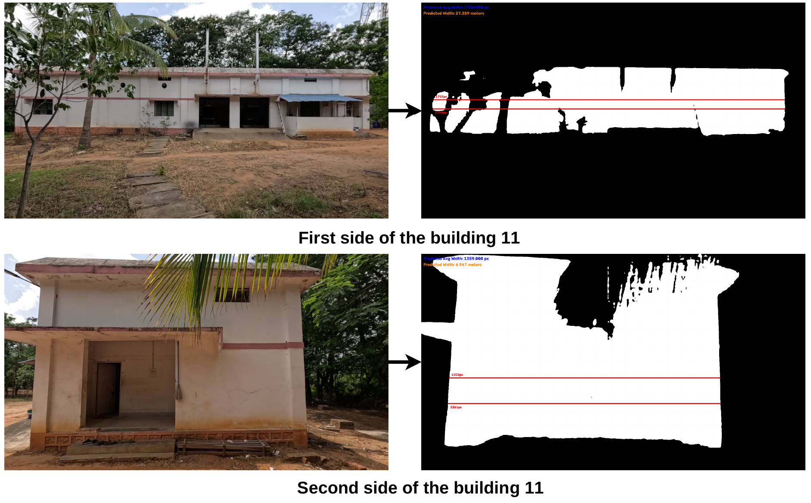

# Built-Up Area Estimation

This repository contains the supplementary material associated with the paper:

**"Built-Up Area Estimation from Handheld RGB-D Sensing Enabled by Vision Foundation Models"**

submitted to *IEEE Sensors Letters*.

---
## Introduction and Method Overview

This repository provides supplementary material supporting a vision-based
approach for estimating the built-up (footprint) area of buildings from
handheld RGB-D data. The proposed pipeline processes frames captured with a
handheld RGB camera (GoPro HERO12 Black) and a hardware-synchronized
Time-of-Flight (ToF) depth sensor (Terabee TeraRanger Evo 60m), and integrates
open-vocabulary object detection, prompt-based segmentation, and geometric
reasoning to measure facade widths automatically, without model training or
fine-tuning.

Despite recent advances, existing methods primarily rely on aerial or satellite
imagery and estimate built-up area from roof projections, which may include
**roof overhangs or architectural extensions**. In contrast, the proposed
street-level RGB-D approach directly measures facade dimensions at ground
level, enabling estimation of the true structural built-up area without custom
training or specialized surveying equipment.

---

## Proposed Built-Up Area Estimation Pipeline

The figure below illustrates the architecture of the proposed automatic
Built-Up Area Estimation Module. For each facade, one frame and its ToF depth
reading are processed in the following stages:

1. **Preprocessing:** lens distortion correction (done in-camera by the GoPro's
   Linear lens mode) and HSV-based vegetation removal.
2. **Building detection:** Grounding DINO detects buildings using the text
   prompt "building".
3. **Facade segmentation:** the Segment Anything Model (SAM) segments each
   detected box, using the box as its prompt.
4. **Target selection:** the box with the largest facade mask is taken as the
   target building.
5. **Width estimation:** on each row of the facade mask, the extent between the
   outermost building pixels is measured. Rows touching the image border or
   with vegetation at either end are rejected. Consecutive rows whose extent and
   both edges agree form bands, and the band supported by the most rows is
   taken as the wall, which rejects thin roof overhangs and mask bleed into the
   ground. The pixel width is the median over the rows of this band and is
   converted to metres using the ToF depth *Z* and the focal length
   *fx*: *W* = *Z* · *L*px / *fx*.
6. **Built-up area:** the widths of two orthogonal facades are multiplied,
   *A* = *W*1 × *W*2.

---

## Qualitative Example

An example of built-up area estimation for Building-11 is shown below. Images
were captured from two orthogonal sides of the building along with their
corresponding depth measurements. Vegetation removal improves the visibility of
structural features, enabling accurate facade segmentation at a distance of
15.50 m. The two red lines on each mask are two rows of the automatically
selected band.

**Ground Truth Area:** 183.885 m²  
**Estimated Built-Up Area:** 190.611 m²  
**Relative Error:** 3.658 %

---

## Quantitative Error Analysis

The table below summarizes the statistical error metrics for facade width and
built-up area estimation across the 22 evaluated buildings (two orthogonal
facades each). Errors are computed with respect to tape-measured ground truth.

| Error Metric | Estimated Width Error (%) | Estimated Built-Up Area Error (%) |
|:------------:|:-------------------------:|:---------------------------------:|
| Mean error (μₑ) | 2.414 | 3.409 |
| Standard deviation error (σₑ) | 1.741 | 2.458 |
| Maximum error (eₘₐₓ) | 6.822 | 8.256 |
| Root mean square error (RMSE) | 2.965 | 4.170 |
| 95% confidence interval of μₑ | 1.89–2.94 | 2.32–4.50 |

---

## Repository Contents

- `supplementary_material.pdf`  
  Per-building results for all 22 buildings: for each facade, the RGB frame,
  the facade mask with the selected band, ToF depth, actual and predicted
  width, and width error; the built-up area and its error for each building;
  and a summary table of the error metrics.

- `architecture_pipeline.png`  
  Visual illustration of the proposed automatic Built-Up Area Estimation
  pipeline.

- `Built_Up_Area_Gen.png`  
  Qualitative example (Building-11) shown above.

---

## Access to Supplementary Material

The supplementary PDF can be accessed directly at:  
https://jayakant-kumar.github.io/built-up-area-supplementary/supplementary_material.pdf

---

## Note

This repository is intended solely for academic review and research
dissemination purposes.
